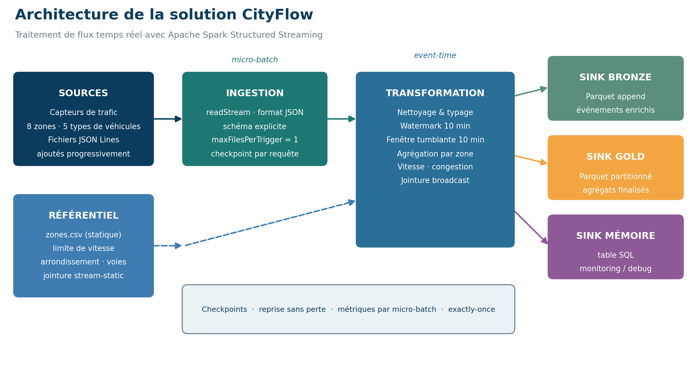
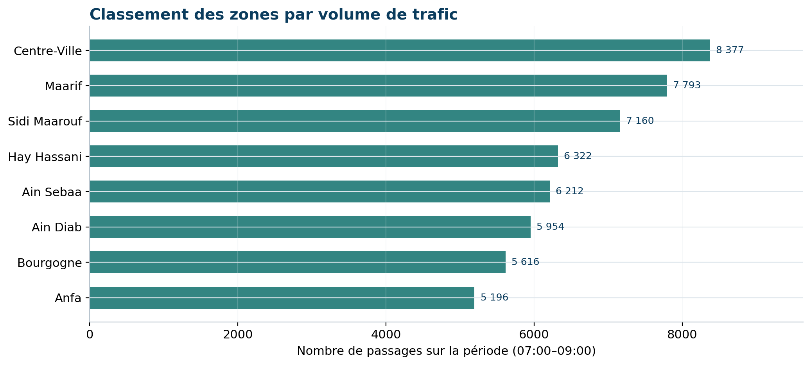
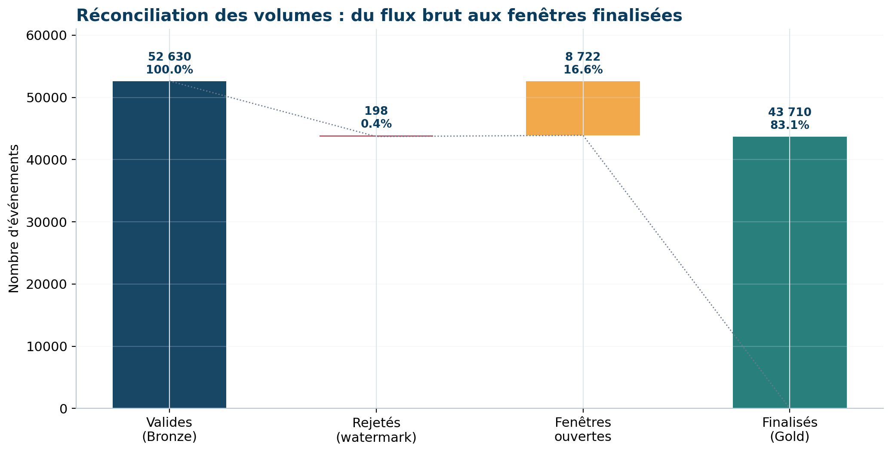

# CityFlow — Real-Time Traffic Intelligence with Apache Spark

**A reproducible PySpark Structured Streaming pipeline for urban traffic analytics.**


CityFlow ingests a progressively arriving stream of traffic events, enriches it with a
static zone reference, and computes reliable **10-minute KPIs per zone** using
**event-time windows**, **watermarking**, **checkpointing**, and **Parquet sinks**. The
same dataset is processed in batch to reconcile results and quantify the cost of late
data.



---

## Contents

- [Overview](#overview)
- [What this project demonstrates](#what-this-project-demonstrates)
- [Results at a glance](#results-at-a-glance)
- [Architecture](#architecture)
- [Repository layout](#repository-layout)
- [Dataset](#dataset)
- [Quick start](#quick-start)
- [Outputs](#outputs)
- [Engineering decisions](#engineering-decisions)
- [Reproducibility](#reproducibility)
- [Limitations and roadmap](#limitations-and-roadmap)
- [Deliverables](#deliverables)
- [Authors and academic context](#authors-and-academic-context)
- [License](#license)

---

## Overview

A mobility operations team needs continuous indicators, not a nightly report. CityFlow
simulates that setting with a **Casablanca traffic control room**: 8 zones, 26 sensors,
and 12 JSON files covering the morning peak from **07:00 to 09:00 UTC**.

The stream is deliberately difficult:

- events arrive out of order;
- **4.2%** of events are late by 6 to 45 minutes;
- **0.4%** of JSON lines are intentionally corrupted;
- the stream is finite, so the last windows never receive a later event.

For every zone and every 10-minute window, the pipeline produces:

- vehicle passages (`vehicle_count`);
- average, median, and 95th-percentile speed;
- congestion rate and traffic state;
- number of active sensors.

The main challenge is not the aggregation itself. It is producing the **right result at
the right time**, while accepting bounded lateness and rejecting events that would
change an already-finalized window.

---

## What this project demonstrates

- **Streaming ingestion** with an explicit schema and `maxFilesPerTrigger=1`.
- **Event-time processing** with 10-minute tumbling windows.
- **Stateful aggregation** bounded by a 10-minute watermark.
- **Stream-static enrichment** through a broadcast join with `zones.csv`.
- **Durable Bronze/Gold sinks** with independent checkpoints.
- **Late-event handling** with explicit rejection counts, not silent data loss.
- **Batch/stream reconciliation** on the same deterministic dataset.
- **Observability** through per-micro-batch metrics and a `batch_id`.
- **Reproducible engineering**: deterministic generator, CLI, notebook, tests, and
  documentation.

**Skills demonstrated:** PySpark, Spark Structured Streaming, stateful stream
processing, event-time semantics, watermarking, Parquet, data modeling, Python, Jupyter,
technical writing.

---

## Results at a glance

Measurements from the reference run (Python 3.12, PySpark 3.5.3, Java 17). Volumes are
deterministic; runtimes depend on the machine.

| Metric | Value |
|---|---:|
| Source files | 12 |
| Events generated | 52,846 |
| Corrupted JSON lines | 216 (0.4%) |
| Valid events | 52,630 (99.6%) |
| Late events | 2,194 (4.2%) |
| Batch zone × window aggregates | 96 |
| Finalized streaming aggregates | 80 |
| Events in Gold | 43,710 (83.1%) |
| Events rejected by the watermark | 198 (0.4%) |
| Events still in open windows | 8,722 (16.6%) |
| Micro-batches | 13 |
| Streaming runtime | 86.27 s |
| Batch runtime | 25.09 s |
| Average micro-batch latency | 6.88 s |
| Average throughput | 610 events/s |

### Top zones by volume

| Zone | Vehicle passages | Average speed | Congestion rate |
|---|---:|---:|---:|
| Centre-Ville | 8,377 | 17.7 km/h | 87.3% |
| Maarif | 7,793 | 18.9 km/h | 83.5% |
| Sidi Maarouf | 7,160 | 39.9 km/h | 44.8% |
| Hay Hassani | 6,322 | 26.4 km/h | 75.2% |
| Ain Sebaa | 6,212 | 36.6 km/h | 57.5% |



### Key findings

- **Centre-Ville** is both the busiest and the most congested zone: 8,377 passages and
  87.3% congestion.
- Congestion peaks at **08:10 (97.2%)**, while Gold volume peaks at **07:20 (4,505
  passages)**. Congestion is driven by speed, not by volume alone.
- **198 late events (0.4%)** are rejected by the 10-minute watermark. They are counted
  explicitly, not silently dropped.
- **8,722 events** remain in the last two windows because the finite stream ends at
  09:00 and the watermark cannot advance further.
- The event equation closes exactly:
  `52,630 = 43,710 + 198 + 8,722`.
- The full batch calculation produces **96 windows**; streaming finalizes **80** and
  leaves **16** open (`2 windows × 8 zones`). The full batch maximum is **4,555 events at
  07:00**, versus **4,505 at 07:20** in Gold.



---

## Architecture

```text
Progressive JSON files
        │
        ▼
readStream + explicit schema + maxFilesPerTrigger=1
        │
        ▼
Validation / typing / business rules
        │
        ▼
Broadcast join with zones.csv (stream-static)
        │
        ├──► Bronze Parquet: enriched events (audit, replay)
        │
        ▼
withWatermark(event_time, "10 minutes")
groupBy(window(event_time, "10 minutes"), zone_id)
        │
        ├──► Gold Parquet: finalized zone × window KPIs
        ├──► In-memory sink: SQL supervision view
        └──► Console: global window checks
```

| Stage | Implementation |
|---|---|
| Source | JSON Lines files, no Kafka required |
| Ingestion | Explicit schema, one file per micro-batch |
| Enrichment | Broadcast join with the 8-zone reference |
| Aggregation | Tumbling event-time windows of 10 minutes |
| Lateness | 10-minute watermark; rejected events counted |
| Storage | Checkpointed Bronze and Gold Parquet sinks |
| Observability | Per-batch metrics JSONL and `batch_id` |
| Reconciliation | Batch reference vs streaming totals |

---

## Repository layout

```text
.
├── L1_Presentation/
│   ├── CityFlow_Presentation.pptx     # 23-slide defense deck
│   ├── CityFlow_Presentation.pdf
│   ├── build_presentation.py
│   └── assets/                        # figures used by the deck
├── L2_Code/
│   ├── notebooks/
│   │   ├── CityFlow_Streaming.ipynb   # executed teaching notebook
│   │   └── build_notebook.py
│   ├── scripts/
│   │   ├── generate_dataset.py        # deterministic dataset generator
│   │   ├── inspect_dataset.py         # integrity check
│   │   ├── spark_session.py           # Spark + Windows Hadoop setup
│   │   ├── cityflow_lib.py            # schema, cleaning, aggregations, sinks
│   │   ├── cityflow_pipeline.py       # CLI: available / live / batch
│   │   ├── stream_producer.py         # progressive file arrival
│   │   └── build_figures.py           # figures and summary tables
│   └── requirements.txt
├── L3_Dataset/
│   ├── data/
│   │   ├── stream/                    # 12 JSON Lines files
│   │   ├── reference/zones.csv        # 8-zone reference
│   │   └── metadata.json              # volumes and generation parameters
│   └── README_dataset.md              # detailed dataset documentation (FR)
├── L4_Fiche_TP/
│   ├── Fiche_TP_CityFlow.md
│   ├── Fiche_TP_CityFlow.docx
│   ├── Fiche_TP_CityFlow.pdf          # 17-page lab sheet
│   └── build_fiche.py
├── docs/                              # images used by this README
├── output/
│   ├── bronze_events/                 # enriched events
│   ├── gold_windows/                  # finalized aggregates
│   ├── batch_windows/                 # batch reference
│   ├── metrics/                       # per-micro-batch metrics
│   ├── tables/                        # CSV and KPIs for the defense
│   ├── results_summary.json
│   └── batch_summary.json
├── tools/hadoop/bin/                  # winutils.exe + hadoop.dll (Windows)
├── README.md                          # English documentation
├── README.fr.md                       # French documentation
└── .gitignore
```

---

## Dataset

The dataset is **fully synthetic**: no real sensors and no personal data. It is designed
to make late data, corrupt records, and state management observable.

| Property | Value |
|---|---|
| Generation | `generate_dataset.py`, Python standard library |
| Seed | `20261102` |
| Period | `2026-11-02T07:00:00Z` → `2026-11-02T09:00:00Z` |
| Time zone | UTC |
| Files | 12 JSON Lines files, one per 10-minute slot |
| Zones | 8 Casablanca zones |
| Sensors | 26 (`Z01-S01` … `Z08-S04`) |
| Vehicle types | `car`, `taxi`, `moto`, `bus`, `truck` |
| Size | about 10.3 MB |
| Late events | 4.2%, delayed by 6 to 45 minutes |
| Corrupted lines | 0.4%, truncated JSON |

Each JSON line follows this schema:

```json
{
  "event_id": "EVT-202611020700-000001",
  "event_time": "2026-11-02T07:00:22.630Z",
  "zone_id": "Z01",
  "zone_name": "Centre-Ville",
  "sensor_id": "Z01-S01",
  "lane": 1,
  "vehicle_type": "taxi",
  "speed_kmh": 24.8
}
```

The `zones.csv` reference adds the district, speed limit, and lane count. It is joined as
a **broadcast stream-static join**, so the zone name always comes from the reference and
not from the event payload.

Detailed documentation: [`L3_Dataset/README_dataset.md`](L3_Dataset/README_dataset.md).

---

## Quick start

### Requirements

- **Python 3.10+** (3.12 tested)
- **Java 17** with `JAVA_HOME` set
- **PySpark 3.5.3**
- About **4 GB of RAM**
- Windows, Linux, or macOS

On Windows, `spark_session.py` copies the bundled `winutils.exe` and `hadoop.dll` to
`%TEMP%\cityflow_hadoop\bin`, then configures `HADOOP_HOME` and `java.library.path`.
No manual Hadoop installation is required.

### Installation

From the repository root:

```powershell
python -m pip install --upgrade pip
python -m pip install -r L2_Code/requirements.txt
```

Quick environment check:

```powershell
python -c "import pyspark, pandas, matplotlib; print(pyspark.__version__)"
java -version
```

> Replace `python` with `python3` on systems where needed. All scripts resolve paths from
> the repository root, so they can be launched from any directory.

### 1. Validate the dataset

```powershell
python L2_Code/scripts/inspect_dataset.py
```

The script checks files, lines, corrupt records, and late events, then prints
`Statut : OK`.

### 2. Run the streaming pipeline (reproducible mode)

```powershell
python L2_Code/scripts/cityflow_pipeline.py --mode available
```

`available` processes every present file, **one file per micro-batch**, then stops. This
is the reference mode used for the measurements and the defense.

### 3. Run the batch reference

```powershell
python L2_Code/scripts/cityflow_pipeline.py --mode batch
```

The batch mode reads the same files in a single static pass and writes
`output/batch_windows/` and `output/batch_summary.json`.

### 4. Open the notebook

```powershell
jupyter notebook L2_Code/notebooks/CityFlow_Streaming.ipynb
```

The notebook is already executed with outputs and charts. To replay it end to end:

```powershell
jupyter nbconvert --to notebook --execute --inplace L2_Code/notebooks/CityFlow_Streaming.ipynb
```

### 5. Optional: simulate a live stream

Use two terminals.

**Terminal 1 — file producer:**

```powershell
python L2_Code/scripts/stream_producer.py --clean --interval 5
```

**Terminal 2 — streaming pipeline:**

```powershell
python L2_Code/scripts/cityflow_pipeline.py --mode live --source-dir L3_Dataset/data/incoming --duration 120
```

The producer copies the 12 files one by one into `L3_Dataset/data/incoming/`. The
pipeline detects them and updates its aggregates. `Ctrl+C` stops the queries cleanly.

### 6. Optional: regenerate the dataset and assets

```powershell
python L2_Code/scripts/generate_dataset.py --clean
python L2_Code/scripts/build_figures.py
python L1_Presentation/build_presentation.py
```

The generator is deterministic (seed `20261102`): events are identical across runs. Only
runtime measurements and the `generated_at` metadata field change.

To export the presentation to PDF with LibreOffice:

```powershell
& "C:\Program Files\LibreOffice\program\soffice.com" --headless --convert-to pdf --outdir L1_Presentation L1_Presentation/CityFlow_Presentation.pptx
```

> On Windows with a non-ASCII path (OneDrive, accented or Japanese characters),
> LibreOffice may fail when writing directly into the project. Convert to a neutral path
> such as `%TEMP%\cityflow_pdf`, then copy the PDF back.

---

## Outputs

| Path | Content |
|---|---|
| `output/bronze_events/` | Valid, typed, enriched events (Parquet) |
| `output/gold_windows/` | Finalized zone × window aggregates (Parquet) |
| `output/batch_windows/` | Batch reference aggregates (Parquet) |
| `output/metrics/stream_batches.jsonl` | One metrics record per micro-batch |
| `output/tables/` | CSV tables and consolidated KPIs |
| `output/results_summary.json` | Streaming KPIs and execution metadata |
| `output/batch_summary.json` | Batch KPIs and execution metadata |
| `output/checkpoints/` | Local Spark checkpoint state (not committed) |

---

## Engineering decisions

| Topic | Decision | Why |
|---|---|---|
| Source | JSON Lines files instead of Kafka | Kafka was not required; files make the demo reproducible |
| Ingestion | Explicit schema | Avoids inference cost and keeps corrupt records under control |
| Trigger | `maxFilesPerTrigger=1` | One file per micro-batch makes the stream observable |
| Time semantics | `window(event_time, "10 minutes")` | Tumbling windows match the 10-minute file cadence |
| Lateness | `withWatermark("event_time", "10 minutes")` | Bounds state and gives a clear acceptance rule |
| Enrichment | Broadcast join with `zones.csv` | The reference is small; no unnecessary shuffle |
| Distinct count | `approx_count_distinct` | Compatible with streaming aggregation |
| File name | `input_file_name()` before the join | Prevents the static side from breaking lineage |
| Memory sink | `outputMode("complete")` | Avoids duplicate rows in the supervision view |
| `foreachBatch` | `batch_df.count()` instead of `rdd.isEmpty()` | Avoids an unsupported RDD action on streaming DataFrames |
| Checkpoints | One per query | Independent recovery and clean offsets |
| Windows | `winutils.exe` / `hadoop.dll` copied to `%TEMP%` | Avoids non-ASCII path issues on Windows |

---

## Reproducibility

- Generator seed: `20261102`
- Period: `2026-11-02T07:00:00Z` → `2026-11-02T09:00:00Z`
- Time zone: UTC
- Volumes are deterministic; runtimes depend on the machine.
- Reference outputs are stored in `output/`.
- The executed notebook is committed with its outputs and charts.

Full replay:

```powershell
python L2_Code/scripts/generate_dataset.py --clean
python L2_Code/scripts/cityflow_pipeline.py --mode available
python L2_Code/scripts/cityflow_pipeline.py --mode batch
python L2_Code/scripts/build_figures.py
python L1_Presentation/build_presentation.py
```

---

## Limitations and roadmap

**Assumed limitations**

- The file source simulates a stream; it is not a production broker.
- 13 micro-batches are enough to demonstrate behavior, not to benchmark scale.
- The watermark is fixed at 10 minutes and is not adaptive.
- `event_id` is unique in the dataset, but the pipeline does not deduplicate re-emissions.
- Parquet provides neither ACID transactions nor schema evolution.
- There is no production dashboard or alerting layer.

**Roadmap**

- Replace files with **Apache Kafka** or another durable broker.
- Move to **Delta Lake / Iceberg** for ACID, schema evolution, and time travel.
- Deduplicate on `event_id` with a state store.
- Make the watermark adaptive to observed lateness.
- Add **Grafana / Superset** dashboards and congestion alerts.
- Package the pipeline with Docker and a CI workflow.

---

## Deliverables

| Deliverable | Content | Location |
|---|---|---|
| **L1 — Presentation** | 23-slide defense deck, speaker notes, PDF | `L1_Presentation/` |
| **L2 — Code** | Executed notebook and reproducible Python scripts | `L2_Code/` |
| **L3 — Dataset** | 12 JSON files, zone reference, metadata | `L3_Dataset/` |
| **L4 — Lab sheet** | 17-page step-by-step lab, expected results | `L4_Fiche_TP/` |
| **Results** | Parquet, CSV, JSON, and figures | `output/` |

The defense deck and the lab sheet are written in French, the course language. This
README is the English entry point for the repository. A French version is available in
[`README.fr.md`](README.fr.md).

---

## Authors and academic context

| | |
|---|---|
| **Module** | Écosystème Big Data 2 |
| **Instructor** | Pr. Soukaina Gouraguine |
| **Academic year** | 2026–2027 |
| **Authors** | Mazine CHATER · Yahya BAID · Wenn Bouka DIEUMERCI |
| **Scenario** | Casablanca urban traffic, 8 zones, 2-hour morning peak |
| **Stack** | Python 3.12 · PySpark 3.5.3 · Jupyter · Parquet |

---

## License

Educational and portfolio project. The code and the synthetic dataset are shared for
learning and demonstration purposes, with attribution to the authors. The dataset
contains no real, personal, or proprietary data. It must not be used for operational
traffic decisions.
